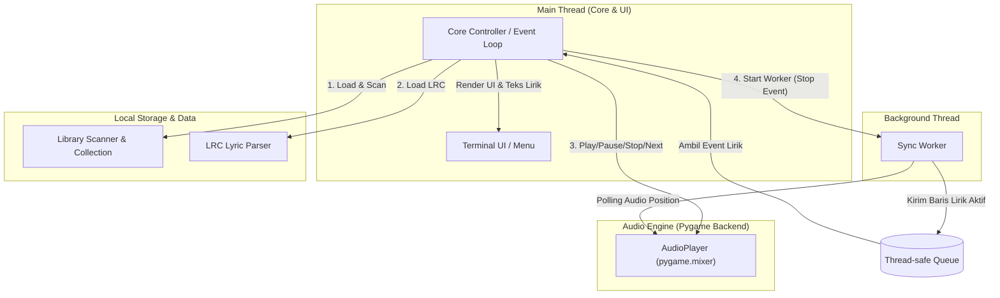
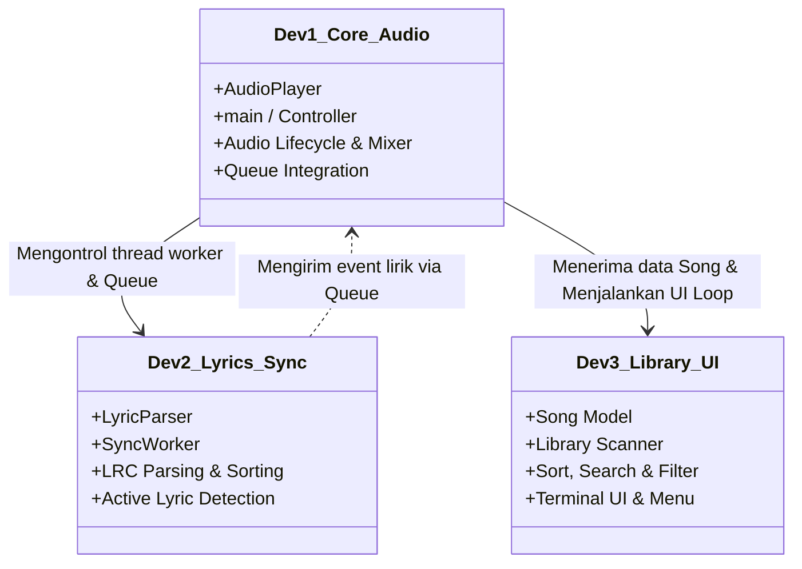

# Software Requirements Specification (SRS)
## Terminal Music & Lyric Player

> **Dokumen Spesifikasi Kebutuhan Sistem & Panduan Kolaborasi Tim**  
> **Versi Dokumen:** 1.0 (Draft Kerja Tim 3 Orang)  
> **Status:** Aktif / Dalam Pengembangan  
> **Sumber:** Dikonversi dari `SRS_Terminal_Music_Lyric_Player_Tim_3_Orang.xlsx`

---

## Daftar Isi
1. [Ringkasan & Panduan Proyek](#1-ringkasan--panduan-proyek)
2. [Spesifikasi Dokumen SRS](#2-spesifikasi-dokumen-srs)
   - 2.1 [Pendahuluan](#21-pendahuluan)
   - 2.2 [Deskripsi Umum](#22-deskripsi-umum)
   - 2.3 [Batasan & Asumsi](#23-batasan--asumsi)
   - 2.4 [Arsitektur Sistem](#24-arsitektur-sistem)
   - 2.5 [Aturan Bisnis](#25-aturan-bisnis)
   - 2.6 [Kriteria Penerimaan Umum](#26-kriteria-penerimaan-umum)
   - 2.7 [Di Luar Scope v1.0](#27-di-luar-scope-v10)
3. [Daftar Kebutuhan Sistem (Requirements) & Checklist Status](#3-daftar-kebutuhan-sistem-requirements--checklist-status)
   - 3.1 [Functional Requirements (FR)](#31-functional-requirements-fr)
   - 3.2 [Non-Functional Requirements (NFR)](#32-non-functional-requirements-nfr)
4. [Pemetaan Peran & Jobdesk (3 Developer)](#4-pemetaan-peran--jobdesk-3-developer)
   - 4.1 [Developer 1: Core, Audio & Integrasi](#41-developer-1-core-audio--integrasi)
   - 4.2 [Developer 2: Lyrics & Synchronization](#42-developer-2-lyrics--synchronization)
   - 4.3 [Developer 3: Library, Playlist & Terminal UI](#43-developer-3-library-playlist--terminal-ui)
5. [Kontrak Interface Antar-Modul](#5-kontrak-interface-antar-modul)
6. [Task Breakdown, Dependensi & Checklist Progres](#6-task-breakdown-dependensi--checklist-progres)
7. [Test Plan & Skenario Pengujian](#7-test-plan--skenario-pengujian)
8. [Milestones Pengembangan](#8-milestones-pengembangan)

---

## 1. Ringkasan & Panduan Proyek

Workbook ini menjadi acuan spesifikasi kebutuhan sistem, pembagian tugas 3 anggota, kontrak antarmuka (*interface*), serta pengujian implementasi.

| Informasi | Keterangan |
| :--- | :--- |
| **Tujuan Dokumen** | Menjadi acuan kebutuhan sistem (SRS), pembagian jobdesk 3 anggota, kontrak interface, dan pengujian. |
| **Asumsi Proyek** | Aplikasi CLI Python; audio lokal format MP3; lirik format LRC; `pygame.mixer` untuk playback audio; `threading` + `Queue` untuk sinkronisasi lirik real-time. |
| **Pembagian Tim** | **3 Anggota:** 1. *Developer 1:* Core, Audio & Integrasi 2. *Developer 2:* Lyrics & Synchronization 3. *Developer 3:* Library, Playlist & Terminal UI |
| **Prinsip Konkurensi & UI** | `pygame.mixer.music.play()` berjalan secara asynchronous di level backend pygame (tidak perlu thread terpisah untuk memutar audio). Worker sinkronisasi berjalan di background thread, membaca posisi audio secara berkala, dan mengirimkan event lirik melalui `queue.Queue`. **Hanya Main Thread yang berhak memperbarui tampilan terminal (UI).** |
| **Batasan Awal** | Durasi lagu, target performa final, target OS final, dan playlist persisten belum ditetapkan. Target interval polling worker sync awal adalah ~100 ms (harus diuji kestabilannya). |

---

## 2. Spesifikasi Dokumen SRS

### 2.1 Pendahuluan
* **1.1 Tujuan:** Menyediakan spesifikasi kebutuhan yang disepakati bersama oleh tim agar setiap anggota memahami cakupan fitur, batasan arsitektur, tanggung jawab modul masing-masing, serta kriteria penerimaan sistem.
* **1.2 Ruang Lingkup:** Aplikasi Command Line Interface (CLI) untuk memutar musik lokal berformat MP3 dan menampilkan lirik berkas LRC secara otomatis dan tersinkronisasi. Fitur manajemen library mencakup scanning folder, penayangan daftar lagu (listing), pengurutan (sorting), pencarian (searching), pemfilteran (filtering), dan pemutaran dari playlist dasar.
* **1.3 Definisi:**
  * **CLI:** *Command Line Interface* (antarmuka berbasis baris perintah teks).
  * **LRC:** Format teks lirik dengan penanda waktu (*timestamp*, misal `[01:23.45]`).
  * **Queue:** Antrean aman lintas-thread (*thread-safe queue*) untuk pertukaran pesan antar-thread di Python.
  * **Main Thread:** Thread utama yang menangani input keyboard pengguna dan rendering UI terminal.
  * **Sync Worker:** Background thread yang bertugas mengecek posisi audio dan mendeteksi perubahan baris lirik aktif.

### 2.2 Deskripsi Umum
* **2.1 Profil Pengguna:**
  * *Pengguna Umum:* Menikmati musik lokal di terminal dengan tampilan lirik sinkron yang rapi dan kontrol playback mudah.
  * *Developer / Maintainer:* Mengembangkan, memperluas, dan memelihara modul audio, lirik, library, atau UI secara terisolasi.
* **2.2 Lingkungan Operasi:**
  * Python 3.10+ (atau Python 3.x standar).
  * Lintas platform: Linux & Windows.
  * Dependensi eksternal: `pygame`.
  * Modul bawaan (Standard Library): `pathlib`, `threading`, `queue`, `dataclasses`, `datetime`, `unittest`.

### 2.3 Batasan & Asumsi
* Audio wajib berformat MP3 lokal.
* Lirik wajib bertimestamp standar LRC.
* File musik dan lirik disediakan oleh user pada folder lokal (misal `data/music/` dan `data/lyrics/`).
* Metadata artis dan durasi bersifat opsional (dapat bernilai `None` bila tidak tersedia).
* Sinkronisasi awal ditargetkan pada interval polling 100 ms dan harus divalidasi saat pengujian.

### 2.4 Arsitektur Sistem

Sistem mengadopsi arsitektur modular dengan pemisahan tugas yang jelas antar-komponen:

### 2.5 Aturan Bisnis
1. File MP3 tanpa pasangan file LRC tetap harus dapat diputar normal tanpa error/crash.
2. Lirik aktif adalah baris lirik bertimestamp terbaru yang nilainya $\le$ posisi audio saat ini.
3. Operasi sorting, search, atau filter tidak boleh merusak urutan asli atau memodifikasi data koleksi sumber secara tidak sengaja.
4. Ketika lagu berganti (*track change*), worker sinkronisasi lagu sebelumnya harus dihentikan dengan aman dan state dibersihkan sebelum lagu baru diputar.

### 2.6 Kriteria Penerimaan Umum
* Pengguna dapat memindai folder lagu, melihat daftar, melakukan pencarian, sorting, dan filtering.
* Pengguna dapat memutar, menjeda (*pause*), melanjutkan (*resume*), menghentikan (*stop*), dan berpindah lagu (*next/prev*).
* Lirik tampil secara otomatis mengikuti alur audio secara responsif.
* Aplikasi dapat keluar dengan bersih (*clean exit*) tanpa menyisakan thread aktif (*hanging process*).
* Seluruh manipulasi tampilan terminal hanya terjadi di Main Thread.

### 2.7 Di Luar Scope v1.0
* Fitur streaming musik online / cloud audio.
* Akun pengguna, autentikasi, atau sinkronisasi cloud.
* Pengambilan lirik otomatis dari API internet.
* Audio visualizer grafis spektrum frekuensi tinggi.
* Format audio selain MP3 (misal FLAC, WAV, AAC, OGG).

---

## 3. Daftar Kebutuhan Sistem (Requirements) & Checklist Status

Status pekerjaan di bawah ini dipetakan berdasarkan codebase terkini di repository:
- `[x]` **Selesai**: Sudah diimplementasikan dan diverifikasi di kode.
- `[ ]` **Belum Selesai**: Belum ada implementasi atau masih dalam bentuk modul kosong.

### 3.1 Functional Requirements (FR)

| ID | Kategori | Kebutuhan Sistem (Requirement) | Prioritas | PIC / Penanggung Jawab | Status |
| :---: | :---: | :--- | :---: | :--- | :---: |
| **FR-01** | Functional | Sistem dapat memindai direktori dan menemukan file MP3. | **Must** | Dev 3 (Library) | `[ ]` |
| **FR-02** | Functional | Sistem dapat menemukan file LRC dan mencocokkannya dengan MP3 berdasarkan aturan nama file yang disepakati. | **Must** | Dev 3 (Library) | `[ ]` |
| **FR-03** | Functional | Sistem dapat menampilkan daftar lagu beserta judul, artis (jika ada), durasi, dan status ketersediaan LRC. | **Must** | Dev 3 (Library + UI) | `[ ]` |
| **FR-04** | Functional | Pengguna dapat memutar (*play*), menjeda (*pause*), melanjutkan (*resume*), dan menghentikan (*stop*) lagu. | **Must** | Dev 1 (Audio) | `[x]` |
| **FR-05** | Functional | Pengguna dapat berpindah ke lagu berikutnya (*next*) dan sebelumnya (*previous*). | **Should** | Dev 1 & 3 (Audio + UI) | `[x]` |
| **FR-06** | Functional | Sistem dapat mengambil posisi playback audio (`get_position`) dalam detik untuk kebutuhan sinkronisasi. | **Must** | Dev 1 (Audio) | `[x]` |
| **FR-07** | Functional | Sistem dapat membaca timestamp dan teks dari file LRC yang valid. | **Must** | Dev 2 (Lyrics) | `[x]` |
| **FR-08** | Functional | Sistem mengurutkan entri lirik berdasarkan timestamp dan menangani timestamp/format yang tidak valid. | **Must** | Dev 2 (Lyrics) | `[x]` |
| **FR-09** | Functional | Sync Worker memeriksa posisi audio secara berkala dan menentukan lirik aktif saat ini. | **Must** | Dev 2 (Sync) | `[x]` |
| **FR-10** | Functional | Sync Worker hanya mengirimkan event ke Queue ketika terjadi perubahan lirik aktif. | **Must** | Dev 2 (Sync) | `[x]` |
| **FR-11** | Functional | Main Thread mengambil event dari Queue dan menjadi satu-satunya pihak yang memperbarui UI terminal. | **Must** | Dev 1 & 3 (Core + UI) | `[x]` |
| **FR-12** | Functional | Pengguna dapat mengurutkan lagu berdasarkan judul (A-Z, Z-A), artis, durasi, dan tanggal ditambahkan. | **Should** | Dev 3 (Library) | `[ ]` |
| **FR-13** | Functional | Pengguna dapat mencari lagu berdasarkan judul atau nama artis (*case-insensitive*). | **Should** | Dev 3 (Library) | `[ ]` |
| **FR-14** | Functional | Pengguna dapat memfilter lagu berdasarkan ketersediaan lirik (LRC) dan nama artis. | **Should** | Dev 3 (Library) | `[ ]` |
| **FR-15** | Functional | Pengguna dapat membuat playlist, menambah/menghapus lagu, melihat isi playlist, dan memutar lagu dari playlist. | **Could** | Dev 3 (Library + UI) | `[ ]` |
| **FR-16** | Functional | Sistem dapat menangani lagu tanpa file LRC secara anggun tanpa menyebabkan error/crash. | **Must** | Dev 1 & 2 (Lyrics + Core) | `[x]` |
| **FR-17** | Functional | Sistem dapat menghentikan Sync Worker melalui `threading.Event` dan menunggunya dengan `join()`. | **Must** | Dev 1 & 2 (Core + Sync) | `[x]` |
| **FR-18** | Functional | Sistem menghentikan playback audio dan membersihkan seluruh resource pygame saat aplikasi ditutup. | **Must** | Dev 1 (Audio + Core) | `[x]` |

---

### 3.2 Non-Functional Requirements (NFR)

| ID | Kategori | Kebutuhan Non-Fungsional | Prioritas | PIC | Status |
| :---: | :---: | :--- | :---: | :--- | :---: |
| **NFR-01** | Performance | Target interval polling sinkronisasi awal ~100 ms; UI tidak boleh melakukan re-render jika tidak ada perubahan state. | **Should** | Dev 1, 2, 3 (Core/Sync/UI) | `[x]` |
| **NFR-02** | Reliability | File MP3/LRC rusak atau corrupt ditangani dengan pesan error yang jelas; satu file bermasalah tidak boleh menggagalkan seluruh library. | **Must** | Semua Modul | `[x]` |
| **NFR-03** | Maintainability | Setiap modul memiliki pemisahan tanggung jawab yang jelas dan interface fungsi terdokumentasi (type hint & docstring). | **Must** | Semua Anggota | `[x]` |
| **NFR-04** | Concurrency | Tidak ada operasi update terminal langsung dari background thread; komunikasi antar-thread wajib lewat `queue.Queue`. | **Must** | Dev 1, 2, 3 (Core/Sync/UI) | `[x]` |
| **NFR-05** | Usability | Tampilan menu, status playback, navigasi lagu, dan pesan error jelas serta mudah dimengerti pada terminal. | **Should** | Dev 3 (UI) | `[ ]` |
| **NFR-06** | Portability | Pengelolaan path file wajib menggunakan `pathlib.Path` lintas platform (Linux & Windows). | **Should** | Semua Modul | `[x]` |

---

## 4. Pemetaan Peran & Jobdesk (3 Developer)

Berikut adalah pembagian peran, tanggung jawab, target berkas (*deliverables*), dan checklist status implementasi untuk ketiga developer:

### 4.1 Developer 1: Core, Audio & Integrasi
* **Modul Utama:** `audio/`, `core/`, `main.py`
* **Tanggung Jawab:**
  * Membuat entry point aplikasi dan pengendali utama (*core controller*).
  * Menginisialisasi dan membersihkan `pygame.mixer`.
  * Mengimplementasikan kontrol audio: `play()`, `pause()`, `resume()`, `stop()`, `next()`, `previous()`.
  * Menyediakan pembacaan posisi audio yang akurat (`get_position()`).
  * Mengelola daur hidup aplikasi (*lifecycle*) dan prosedur *clean shutdown*.
  * Mengintegrasikan antarmuka antar-modul dan mengelola thread-safe queue.
* **Target File & Status:**
  - [x] [audio/audio_player.py](file:///home/ahza/Documents/ipb/dasprog/spotify-cli/audio/audio_player.py) *(Selesai - Kontrol audio, next, prev, get_position, cleanup)*
  - [x] [tests/test_audio_player.py](file:///home/ahza/Documents/ipb/dasprog/spotify-cli/tests/test_audio_player.py) *(Selesai - Unit test kontrol audio dasar)*
  - [x] [core/controller.py](file:///home/ahza/Documents/ipb/dasprog/spotify-cli/core/controller.py) *(Selesai - Pengatur event loop, worker lifecycle, Queue polling)*
  - [x] [tests/test_controller.py](file:///home/ahza/Documents/ipb/dasprog/spotify-cli/tests/test_controller.py) *(Selesai - Unit test controller)*
  - [x] [main.py](file:///home/ahza/Documents/ipb/dasprog/spotify-cli/main.py) *(Selesai - CLI terintegrasi penuh dengan audio & lirik real-time)*

---

### 4.2 Developer 2: Lyrics & Synchronization
* **Modul Utama:** `lyrics/`
* **Tanggung Jawab:**
  * Membuat modul parser berkas lirik LRC (`parse_lrc`).
  * Melakukan validasi, normalisasi, dan pengurutan timestamp lirik.
  * Menentukan baris lirik aktif secara real-time berdasarkan posisi detik audio.
  * Membangun `Sync Worker` yang berjalan di thread terpisah.
  * Mengirim notifikasi perubahan lirik ke `queue.Queue`.
  * Menangani kasus lagu tanpa file LRC dan penghentian worker yang aman (`threading.Event`).
* **Target File & Status:**
  - [x] [lyrics/lyric_parser.py](file:///home/ahza/Documents/ipb/dasprog/spotify-cli/lyrics/lyric_parser.py) *(Selesai - Parsing teks LRC, regex timestamp, list of LyricLine)*
  - [x] [lyrics/lyric_sync.py](file:///home/ahza/Documents/ipb/dasprog/spotify-cli/lyrics/lyric_sync.py) *(Selesai - Sync worker, interval polling, event queue)*
  - [x] [tests/test_lyrics.py](file:///home/ahza/Documents/ipb/dasprog/spotify-cli/tests/test_lyrics.py) *(Selesai - Unit test parser & validasi format)*
  - [x] [tests/test_sync.py](file:///home/ahza/Documents/ipb/dasprog/spotify-cli/tests/test_sync.py) *(Selesai - Unit test sync worker & queue change detection)*
  - [x] [data/lyrics/contoh.lrc](file:///home/ahza/Documents/ipb/dasprog/spotify-cli/data/lyrics/contoh.lrc) *(Selesai - Data contoh lirik)*

---

### 4.3 Developer 3: Library, Playlist & Terminal UI
* **Modul Utama:** `library/`, `ui/`
* **Tanggung Jawab:**
  * Merancang model data lagu (`Song`).
  * Membuat scanner direktori untuk mendeteksi file MP3 dan mencocokkan file LRC pasangan.
  * Mengembangkan fungsi listing, sorting (judul/artis/durasi), searching (*case-insensitive*), dan filtering (punya lirik / artis).
  * Mengembangkan modul playlist dasar (buat playlist, tambah/hapus lagu, putar dari playlist).
  * Merancang menu terminal dan tata letak UI interaktif.
  * Menampilkan lirik aktif yang dikirim dari Queue ke terminal melalui Main Thread.
* **Target File & Status:**
  - [x] [library/song.py](file:///home/ahza/Documents/ipb/dasprog/spotify-cli/library/song.py) *(Selesai - Dataclass Song dengan properti `has_lyrics`)*
  - [ ] `library/scanner.py` *(Belum dibuat - Pemindai direktori & pencocok pasangan MP3 + LRC)*
  - [ ] `library/listing.py` / `sorting.py` / `search.py` *(Belum dibuat - Algoritma sort, search, filter)*
  - [ ] `library/playlist.py` *(Belum dibuat - Manajemen daftar putar)*
  - [ ] `ui/terminal_ui.py` / `menu.py` / `lyric_display.py` *(Belum dibuat - Rendering UI terminal)*

---

## 5. Kontrak Interface Antar-Modul

Seluruh modul harus mematuhi tanda tangan (*signature*) fungsi, tipe data masukan/keluaran, dan batasan integrasi berikut:

| Modul | Fungsi / API | Input & Output yang Diharapkan | PIC | Catatan Integrasi |
| :--- | :--- | :--- | :---: | :--- |
| **Audio** | `load(path: Path \| str) -> None` | Input: path MP3. Output: `None` (sukses) atau exception. | Dev 1 | Wajib menangani `FileNotFoundError` dan `ValueError` file tidak valid. |
| **Audio** | `play() -> None` | Memulai playback audio. | Dev 1 | Playback pygame berjalan asinkron di backend. |
| **Audio** | `pause() / resume() / stop()` | Mengendalikan status playback. | Dev 1 | Harus aman dipanggil meski belum ada lagu yang dimuat. |
| **Audio** | `get_position() -> float \| None` | Output: Posisi audio dalam detik (`float`) atau `None` jika tidak aktif. | Dev 1 | Satuan detik (dibagi 1000 dari ms pygame); konsisten saat pause. |
| **Lyrics** | `parse_lrc(path: Path \| str) -> list[LyricLine]` | Input: Path berkas LRC. Output: `list` objek lirik `(timestamp: float, text: str)` terurut. | Dev 2 | Wajib membuang/menangani format rusak; urutkan berdasarkan timestamp menaik. |
| **Sync** | `start(audio, lyrics, queue, stop_event) -> Thread` | Input: Akses posisi audio, data lirik, instance `queue.Queue`, `threading.Event`. Output: Objek background worker/thread. | Dev 2 | **Dilarang keras menyentuh / print ke UI langsung.** Hanya mengirim pesan ke Queue saat lirik berubah. |
| **Sync** | `stop() / join()` | Menghentikan worker secara aman. | Dev 2 | Gunakan `stop_event.set()` dan `worker.join()`. Hindari deadlock. |
| **Library** | `scan_directory(path: Path) -> list[Song]` | Input: Direktori root data. Output: `list[Song]` yang ditemukan. | Dev 3 | Mencocokkan nama file dasar: `<nama>.mp3` dengan `<nama>.lrc`. |
| **Library** | `sort_songs(songs: list[Song], key: str, order: str) -> list[Song]` | Input: Daftar lagu, kriteria urut, urutan (`asc`/`desc`). Output: `list[Song]` baru yang terurut. | Dev 3 | *Pure function* — tidak boleh mengubah (*mutate*) list masukan asli. |
| **Library** | `search_songs(songs: list[Song], keyword: str) -> list[Song]` | Input: List lagu, kata kunci string. Output: `list[Song]` hasil pencocokan. | Dev 3 | Bersifat *case-insensitive* pada judul maupun artis. |
| **Library** | `filter_songs(songs: list[Song], criteria: dict) -> list[Song]` | Input: List lagu, kriteria filter. Output: `list[Song]` hasil filter. | Dev 3 | Kriteria: `has_lyrics: bool`, `artist: str`. |
| **UI** | `render_playlist(songs: list[Song]) -> None` | Input: List Song. Output: Tampilan daftar lagu di terminal. | Dev 3 | Hanya dipanggil dari Main Thread. |
| **UI** | `render_lyric(lyric_text: str) -> None` | Input: Teks lirik yang sedang aktif. Output: Update tampilan baris lirik di layar. | Dev 3 | Hanya dipanggil dari Main Thread saat event diterima dari Queue. |
| **Core** | `run() / shutdown() -> None` | Menjalankan main loop, membaca input, polling Queue, dan mematikan komponen. | Dev 1 | Core menjadi pemilik mutlak siklus hidup aplikasi (*application lifecycle*). |

---

## 6. Task Breakdown, Dependensi & Checklist Progres

| Task ID | Tahap / Modul | Rincian Task Pekerjaan | PIC | Dependensi | Status |
| :---: | :---: | :--- | :---: | :---: | :---: |
| **T-01** | Fondasi | Sepakati struktur folder, aturan nama file, dan data model `Song` | Semua | Sebelum coding paralel | `[x]` Selesai |
| **T-02** | Fondasi | Sepakati kontrak fungsi antarmuka dan struktur event Queue | Dev 1, 2, 3 | Lihat Bab Interface | `[x]` Selesai |
| **T-03** | Audio | Implementasi inisialisasi mixer dan load file MP3 | Dev 1 | T-01 | `[x]` Selesai |
| **T-04** | Audio | Implementasi kontrol playback: play, pause, resume, stop, next, prev | Dev 1 | T-03 | `[x]` Selesai |
| **T-05** | Lyrics | Implementasi parser file LRC dan validasi format timestamp | Dev 2 | T-01 | `[x]` Selesai |
| **T-06** | Sync | Implementasi algoritma pencocokan posisi audio dengan lirik aktif | Dev 2 | T-02, T-04, T-05 | `[x]` Selesai |
| **T-07** | Sync | Implementasi Queue, Stop Event, dan manajemen lifecycle worker | Dev 1 & 2 | T-02, T-06 | `[x]` Selesai |
| **T-08** | Library | Implementasi scanner direktori MP3/LRC dan pembuatan objek `Song` | Dev 3 | T-01 | `[ ]` To do |
| **T-09** | Library | Implementasi fungsi listing, sorting, searching, dan filtering koleksi | Dev 3 | T-08 | `[ ]` To do |
| **T-10** | Playlist | Implementasi fitur dasar playlist (buat, tambah, hapus, putar) | Dev 3 | T-08, T-09 | `[ ]` To do |
| **T-11** | UI | Implementasi struktur menu dan penampil terminal CLI | Dev 3 | T-01 | `[ ]` To do |
| **T-12** | Integrasi | Integrasi kontrol audio dan penampil lirik via Queue ke Main Thread | Dev 1, 2, 3 | T-04, T-07, T-11 | `[x]` Selesai di Main & Controller |
| **T-13** | Testing | Pembuatan unit test komprehensif pada masing-masing modul | Masing-masing PIC | Setelah modul selesai | `[x]` Selesai untuk Dev 1 & 2 (20 tests passed) |
| **T-14** | Integrasi | Pengujian integrasi (*end-to-end*) seluruh fitur dan perbaikan bug | Semua | T-12, T-13 | `[ ]` Menunggu modul Dev 3 |
| **T-15** | Rilis | Finalisasi dokumentasi (README/SRS), demo aplikasi, dan review akhir | Semua | T-14 | `[ ]` To do |

---

## 7. Test Plan & Skenario Pengujian

Checklist pengujian penerimaan fungsional (*acceptance criteria*) sebelum rilis:

| Test ID | Skenario Uji | Langkah Pengujian Ringkas | Hasil yang Diharapkan (*Expected Result*) | Status |
| :---: | :--- | :--- | :--- | :---: |
| **TC-01** | Scan direktori MP3 | Jalankan scanner pada folder berisi beberapa file MP3. | Semua file MP3 valid terdeteksi dengan benar. | `[ ]` To do |
| **TC-02** | Pencocokan file LRC | Taruh file MP3 dan LRC dengan nama dasar file yang sama. | Objek `Song` menyimpan atribut `lyric_path` yang sesuai. | `[ ]` To do |
| **TC-03** | MP3 tanpa file LRC | Pindai folder dengan MP3 yang tidak memiliki file `.lrc`. | Lagu tetap berhasil masuk library dan dapat diputar tanpa error. | `[ ]` To do |
| **TC-04** | Kontrol playback dasar | Pilih sebuah lagu, lalu uji Play, Pause, Resume, Stop. | Audio merespons perintah dengan tepat; UI tidak membeku (*freeze*). | `[x]` Teruji di AudioPlayer |
| **TC-05** | Parsing format LRC valid | Lakukan parse pada file LRC berformat standar. | Baris lirik dan timestamp terbaca rapi dan terurut kronologis. | `[x]` Passed (Unit Test) |
| **TC-06** | File LRC rusak / tidak valid | Uji file LRC dengan baris rusak atau timestamp cacat. | Error ditangani dengan anggun; sistem tidak crash. | `[x]` Passed (Unit Test) |
| **TC-07** | Sinkronisasi lirik audio | Putar lagu ber-LRC dan amati perpindahan baris lirik. | Baris lirik berganti tepat waktu sesuai posisi detik playback. | `[x]` Passed (Unit Test) |
| **TC-08** | Pengiriman pesan Queue ke UI | Sync Worker mendeteksi perpindahan baris lirik. | Event perubahan lirik masuk Queue dan diambil Main Thread untuk render. | `[x]` Passed (Unit Test) |
| **TC-09** | Sorting daftar lagu | Urutkan koleksi berdasarkan judul A-Z dan Z-A. | Urutan list lagu tertata sesuai kriteria pengurutan. | `[ ]` To do |
| **TC-10** | Searching lagu | Cari kata kunci judul/artis dengan huruf besar/kecil acak. | Hasil pencarian akurat (*case-insensitive*). | `[ ]` To do |
| **TC-11** | Filtering koleksi | Filter lagu berdasarkan ketersediaan LRC dan nama artis. | Menampilkan subset lagu yang tepat sesuai kriteria filter. | `[ ]` To do |
| **TC-12** | Clean shutdown | Tekan keluar (*quit*) saat lagu sedang berjalan. | Audio berhenti seketika, worker mati, thread dibersihkan, exit 0. | `[x]` Teruji dasar di main.py |
| **TC-13** | Integrasi menyeluruh | Uji skenario penuh: scan $\rightarrow$ list $\rightarrow$ search/sort $\rightarrow$ play $\rightarrow$ lirik $\rightarrow$ exit. | Seluruh alur sistem berjalan mulus tanpa tabrakan thread atau crash. | `[ ]` To do |

---

## 8. Milestones Pengembangan

Tahapan *milestone* pengembangan proyek untuk mencegah tim saling menunggu (*blocking*):

| Milestone | Tahapan & Fokus | Kriteria Kelulusan (*Exit Criteria*) | Status Progres |
| :---: | :--- | :--- | :---: |
| **M1** | **Agreement & Foundation** SRS, arsitektur, struktur folder, kontrak interface data model. | Semua anggota menyetujui scope fitur, kontrak API, model `Song`, dan struktur Git. | `[x]` **Selesai** |
| **M2** | **Module Prototype** Audio player, parser LRC, scanner library, dan skeleton UI. | Masing-masing modul dapat diuji mandiri (*isolated unit testing*) dengan data sampel. | `[ ]` **Sedang Berjalan** *(Audio selesai; Lyrics, Scanner, UI belum)* |
| **M3** | **Sync Integration** Koneksi audio position + Sync Worker + Queue + UI rendering. | Lirik aktif terkirim ke Main Thread tanpa ada thread lain yang memodifikasi UI terminal. | `[ ]` Belum Dimulai |
| **M4** | **Feature Complete** Listing, sorting, search, filter, dan playlist dasar. | Seluruh kebutuhan bertaraf *Must* dan *Should* telah berfungsi penuh. | `[ ]` Belum Dimulai |
| **M5** | **Release Candidate** Pengujian integrasi, error handling, dokumentasi, dan demo. | Seluruh skenario pada Test Plan lulus (Pass), shutdown bersih, demo siap disajikan. | `[ ]` Belum Dimulai |
